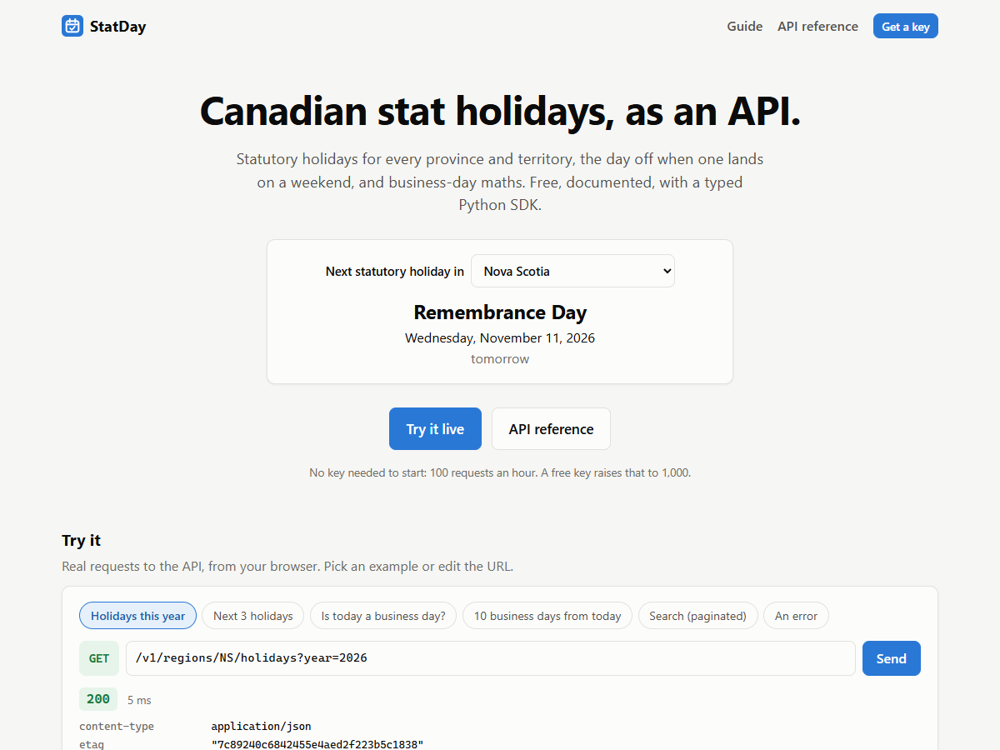
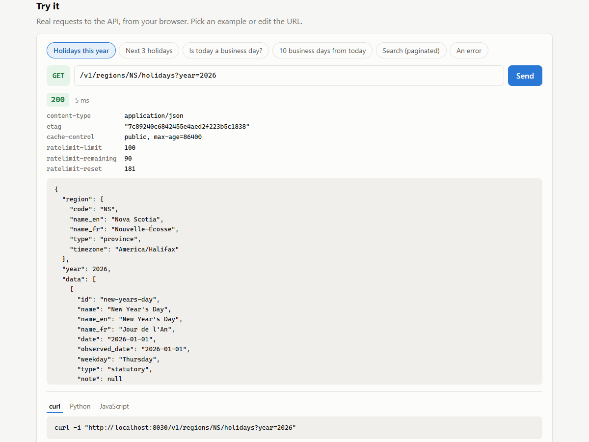
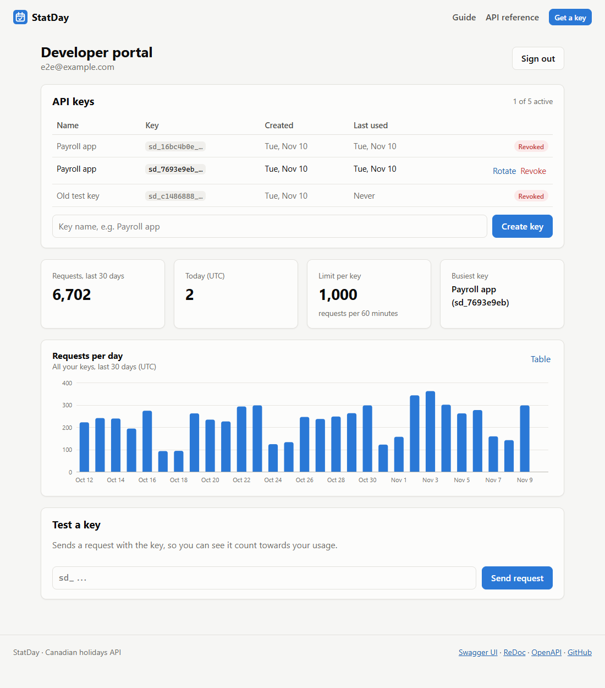

# StatDay

A public REST API for Canadian statutory holidays. It covers every province and territory, plus federally regulated workplaces, from 2023 to 2050. It also answers the questions that come up in payroll and scheduling code: which day is actually off when a holiday lands on a weekend, is this date a business day, and what date is 10 business days from now?

It's built the way a public API should be: versioned URLs, optional self-serve API keys, rate-limit headers, ETag caching, paginated search, one error format everywhere, interactive docs, and a typed Python SDK generated from the OpenAPI spec.

**Live:** https://statday.onrender.com (try the playground, or open the [API reference](https://statday.onrender.com/docs)). It runs on Render's free tier, so the first request after it has been idle can take about a minute.



| Live playground | Developer portal |
|---|---|
|  |  |

## Using it

```bash
curl https://statday.onrender.com/v1/regions/NS/holidays/next
```

```json
{
  "region": "NS",
  "after": "2026-11-10",
  "data": [
    {
      "id": "remembrance-day", "name": "Remembrance Day", "name_fr": "Jour du Souvenir",
      "date": "2026-11-11", "observed_date": "2026-11-11", "weekday": "Wednesday",
      "type": "statutory", "note": "Covered by Nova Scotia's Remembrance Day Act rather than the Labour Standards Code."
    }
  ]
}
```

| Endpoint | What it answers |
|---|---|
| `GET /v1/regions` | The 14 jurisdictions (`CA` = federal, plus provinces and territories) |
| `GET /v1/regions/{region}/holidays?year=` | Every holiday in a region for a year, with observed days off |
| `GET /v1/regions/{region}/holidays/next?count=` | The next holidays from today (in the region's time zone) |
| `GET /v1/regions/{region}/dates/{date}` | Is this a business day? Is it a holiday, or a holiday's day off? |
| `GET /v1/regions/{region}/business-days?start=&end=` | Business days in a range, and the holidays that fall in it |
| `GET /v1/regions/{region}/business-days/add?start=&days=` | The date N business days after (or before) a date |
| `GET /v1/holidays?year=&region=&type=&q=&page=` | Search across the country, paginated |
| `GET /v1/holidays/{id}?year=` | One holiday, its rule, and how each region observes it |

The full reference is at `/docs` (Swagger UI) and `/redoc`. The site's `/guide` page covers rate limits, caching, pagination, errors and versioning.

## Features

- **Holiday data you can check against the law.** Each holiday is one line in `holidays/data.py` with its rule ("Monday before May 25"), the regions where it's statutory, and the regions where it's only commonly observed.
- **Observed dates.** Each region's weekend rules: most move a weekend holiday to the next weekday, Remembrance Day never moves, and Quebec moves only Sunday holidays. Christmas and Boxing Day on a weekend take Monday and Tuesday.
- **Business-day maths** that skips weekends and statutory days off.
- **Self-serve API keys.** Sign up, create, rotate and revoke keys, and see a 30-day usage chart. Keys are optional: anonymous callers get a smaller per-IP allowance.
- **Rate limiting** with `RateLimit-*` headers, and `429` plus `Retry-After` when you go over.
- **HTTP caching.** Every response carries an `ETag` and `Cache-Control`. Sending `If-None-Match` gets back `304 Not Modified` with no body.
- **Pagination** in the body plus `Link` and `X-Total-Count` headers.
- **RFC 9457 errors.** Every error is `application/problem+json`, and its `type` links to that error's section of the guide.
- **Generated Python SDK** (`sdk/python`). CI regenerates it on every push and fails if the committed copy is out of date.

## Tech stack

- **Backend:** Python, FastAPI, SQLAlchemy 2.0, Pydantic, PyJWT; PostgreSQL in production (psycopg 3), SQLite locally
- **Frontend:** React 19 (Vite), React Router, a hand-made SVG chart, plain CSS with light and dark themes
- **SDK:** openapi-python-client, from the app's own OpenAPI document
- **Testing:** pytest (including a Postgres concurrency test), an end-to-end check in headless Chrome
- **DevOps:** Docker (multi-stage), GitHub Actions (Postgres service, SDK drift check), Render + Neon

## How it works

```
backend/app/
  holidays/rules.py     date rules: fixed, nth weekday, weekday before, nearest weekday, Easter offsets
  holidays/data.py      the holiday table: one entry per holiday, statutory vs optional per region
  holidays/calendar.py  dates per region and year, observed days off, business-day maths (pure, cached)
  routers/v1.py         the public API
  routers/portal.py     signup, keys, usage (hidden from the public docs)
  access.py             API key check, rate limit, usage counting (one dependency on every v1 route)
  ratelimit.py          fixed-window limiter
  caching.py            ETags and 304s
  problems.py           RFC 9457 error responses
sdk/
  openapi.json          exported from the app; input to the generator
  python/               the generated client
  example.py
frontend/src/pages/     landing page and playground, guide, developer portal
```

### Holidays as data plus rules

Holidays are data, not code. The calendar is computed from a table:

```python
Holiday("victoria-day", "Victoria Day", "Fête de la Reine", WeekdayBefore(MONDAY, 5, 25),
        regions("CA", "AB", "BC", "MB", "ON", "SK", "NT", "NU", "YT"),  # statutory
        regions("NB", "NL", "NS", "PE")),                                # optional
```

Rules are small frozen dataclasses with `on(year)` and `describe()`. Easter uses the anonymous Gregorian algorithm, and Good Friday is `EasterOffset(-2)`. Everything in `holidays/` is pure functions, cached per region and year, with no database.

### Observed days off without collisions

Observed dates take two passes. First, holidays that stay on their own date claim it. Then each weekend holiday moves forward to the next weekday nobody has claimed. In 2027, Christmas falls on a Saturday and Boxing Day on a Sunday, so they become Monday the 27th and Tuesday the 28th. In 2033, Christmas falls on a Sunday and Boxing Day already holds Monday, so Christmas moves to Tuesday.

### One dependency for keys, limits and usage

Every `/v1` route depends on `api_access`, which:

1. **Checks the key, if one was sent.** It looks up the SHA-256 hash of the key. Only the hash is stored, and the full key is shown once at creation. A wrong or revoked key gets `401` instead of silently falling back to anonymous, so a misconfigured client finds out.
2. **Applies the rate limit.** A fixed window aligned to the hour, per key or per IP address. The decision goes on `request.state`, and a middleware copies the `RateLimit-*` headers onto every response, including errors and 304s.
3. **Counts usage.** It runs `INSERT ... ON CONFLICT DO UPDATE SET count = count + 1` on a (key, day) row. That's one atomic statement, so simultaneous requests can't lose updates. A Postgres test runs 8 threads × 25 requests and checks the total is exactly 200.

### ETags

`cached_json` serialises the response once and hashes the bytes. If the hash matches `If-None-Match` (weak or strong, or a list), the response is a bodyless `304`. Because the ETag is derived from the bytes themselves, nothing needs invalidating when data changes.

### Docs that match the wire

FastAPI documents error models under `application/json`, but the API sends `application/problem+json`. A small hook moves the schemas to the right media type, so Swagger UI is accurate and the generated SDK parses errors into a typed `ProblemDetail` instead of `Any`. Operation ids are set from the function names, so SDK calls read `region_holidays.sync(...)` rather than `region_holidays_v1_regions_region_holidays_get`.

## Run locally

Requires Python 3.12+ and Node 20+.

```bash
# backend
cd backend
python -m venv .venv
source .venv/bin/activate          # Windows: .venv\Scripts\activate
pip install -r requirements.txt
uvicorn app.main:app --reload      # http://localhost:8000/docs

# frontend (second terminal)
cd frontend
npm install
npm run dev                        # http://localhost:5173
```

On Windows, `./start.ps1` opens both in their own windows. A SQLite file is created automatically.

Or run everything in one container:

```bash
docker build -t statday .
docker run -p 8000:8000 -e SECRET_KEY=change-me statday
```

### Configuration

| Variable | Default | Purpose |
|---|---|---|
| `DATABASE_URL` | `sqlite:///./statday.db` | Postgres URLs (`postgres://...`) work as-is |
| `SECRET_KEY` | random per start | Signs portal logins |
| `ANONYMOUS_LIMIT` | `100` | Requests per window per IP without a key |
| `KEY_LIMIT` | `1000` | Requests per window per key |
| `RATE_WINDOW_SECONDS` | `3600` | Window length |
| `MAX_KEYS_PER_DEVELOPER` | `5` | Active keys per account |

## Tests

```bash
cd backend
pytest
```

59 tests cover:

- **Date rules:** Easter (including its earliest and latest possible dates), Victoria Day when May 25 is itself a Monday, Newfoundland's "nearest Monday" days, and Yukon Heritage Day.
- **Each region's statutory list,** checked against its employment standards law.
- **Observed-date shifts** and business-day counting.
- **The API:** filters, pagination headers, problem+json for every error type, ETag/304 (including weak and listed validators), the rate limit and its reset, and bad keys.
- **The portal:** keys stored hashed, rotate and revoke, the key limit, usage counting, and isolation between developers.
- **The committed `openapi.json`** matching the code.

The Postgres usage test runs when `TEST_DATABASE_URL` is set. CI provides one, regenerates the SDK, and runs `sdk/example.py` against a live server.

```bash
docker run -d -p 5433:5432 -e POSTGRES_PASSWORD=pw -e POSTGRES_DB=statday_test postgres:17-alpine
TEST_DATABASE_URL=postgresql://postgres:pw@localhost:5433/statday_test pytest
```

## Design decisions

- **Keys are optional.** Trying an API shouldn't need a signup. The anonymous limit is per IP and best effort, since an IP can be shared or spoofed behind proxies. Keys are the real control, and they come with usage history.
- **SHA-256 for keys, scrypt for passwords.** Passwords are guessable, so they need a slow, memory-hard hash. Keys are 192 random bits, so a fast hash is safe, and it keeps the check on every request cheap.
- **Revoke, don't delete.** Revoked keys keep their usage history in the chart. Rotation revokes the old key and issues a new one with the same name in one step.
- **In-memory rate limiting.** It's correct for one instance, which is what runs. With several instances the counter would move to Redis (`INCR` + `EXPIRE`), and the limiter's interface wouldn't change.
- **Caching can lower your usage count.** Browsers and HTTP caches reuse responses within `max-age`, so those requests never reach the API. That's the point of caching, and it's why the portal can show fewer requests than your code made.
- **2023 to 2050 only.** Several holidays changed recently (Sept 30 became a holiday in some regions in 2021 to 2023), so earlier years would need rule history. Later years are projections of today's law. Out-of-range years get a clear `422` instead of a guess.
- **Additive changes within v1.** New fields and parameters are fine. Anything breaking would ship as `/v2`, alongside v1.
- **The portal isn't in the public docs.** Signup and key management are the website's private backend, so they're excluded from OpenAPI and the SDK.

## Sources

Checked in November 2026 against federal, provincial and territorial employment standards pages, including:

- Nova Scotia: [holiday pay](https://novascotia.ca/lwd/employmentrights/holidaypay.asp) and the [holiday chart](https://novascotia.ca/lae/employmentrights/holidaychart.asp)
- Nunavut: [National Day for Truth and Reconciliation](https://www.gov.nu.ca/justice/news/national-day-truth-and-reconciliation) (added as a general holiday in 2022)
- Newfoundland and Labrador: government releases on which days are [statutory](https://www.releases.gov.nl.ca/releases/2002/labour/1106n06.htm) versus government holidays
- Cross-checked against [canada-holidays.ca](https://canada-holidays.ca)

Treat it as a reference, not legal advice: collective agreements and employment contracts can add days.

## What I'd add next

- Redis-backed rate limits for running more than one instance
- iCalendar feeds (`/v1/regions/NS/holidays.ics`) to subscribe from a calendar app
- A TypeScript SDK from the same spec
- Webhooks or an email when the holiday data changes
- Historical rules before 2023, with each rule's start year
- Alembic migrations once the schema starts changing
